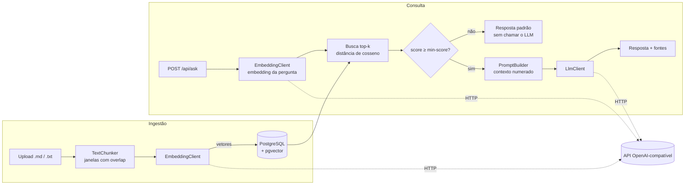
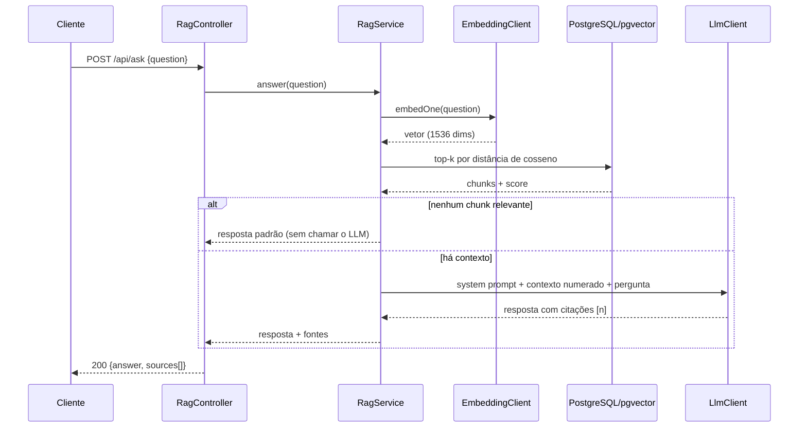

# RAG Assistant

Assistente que responde perguntas sobre documentos (ex.: documentação de uma API) usando **Retrieval-Augmented Generation**. Backend em **Java 21 + Spring Boot 3**, embeddings armazenados em **PostgreSQL + pgvector** e geração via **API de LLM** (formato OpenAI, configurável).

O pipeline RAG é implementado explicitamente (chunking, embeddings, busca vetorial, montagem de prompt), sem framework de IA por cima, para deixar cada etapa visível e testável.

## Arquitetura



Fluxo de uma pergunta:



## Stack

| Camada | Tecnologia |
|---|---|
| Linguagem / framework | Java 21, Spring Boot 3.5 (Web, JDBC, Validation, Actuator) |
| Banco | PostgreSQL 16 + pgvector (índice HNSW, distância de cosseno), migrations com Flyway |
| IA | Embeddings e chat via API compatível com OpenAI (`RestClient`) |
| Testes | JUnit 5, Mockito, AssertJ, MockMvc, `MockRestServiceServer`, Testcontainers |
| Infra | Docker (multi-stage), Docker Compose |

## Como rodar

Pré-requisitos: Docker e uma chave de API compatível com OpenAI.

```bash
cp .env.example .env        # preencha OPENAI_API_KEY
docker compose up --build
```

A API sobe em `http://localhost:8080`.

Para desenvolver localmente (app fora do Docker):

```bash
docker compose up db
export OPENAI_API_KEY=sk-...
mvn spring-boot:run
```

## Rodar sem custo, com Ollama (modelos locais)

Qualquer API compatível com OpenAI funciona. Com o [Ollama](https://ollama.com/download) o projeto roda sem chave e sem crédito:

```bash
ollama pull nomic-embed-text   # embeddings (768 dimensões)
ollama pull llama3.2           # chat
```

1. Em `src/main/resources/db/migration/V1__init.sql`, troque `vector(1536)` por `vector(768)`.
2. No `.env`:
   ```
   OPENAI_API_KEY=
   LLM_BASE_URL=http://host.docker.internal:11434/v1
   LLM_MODEL=llama3.2
   EMBEDDING_BASE_URL=http://host.docker.internal:11434/v1
   EMBEDDING_MODEL=nomic-embed-text
   RAG_EMBEDDING_DIMENSIONS=768
   ```
   (`host.docker.internal` permite ao container alcançar o Ollama da máquina; com `mvn spring-boot:run`, use `http://localhost:11434/v1`.)
3. Recrie o banco, pois a dimensão da coluna mudou: `docker compose down -v && docker compose up --build`.

A primeira resposta é lenta porque o Ollama carrega o modelo na memória. Os scores de similaridade variam por modelo de embedding; se perguntas óbvias caírem na resposta padrão, reduza `RAG_RETRIEVAL_MIN_SCORE`.

## API

```bash
# indexar um documento (.md, .markdown ou .txt; reenviar o mesmo nome substitui a versão anterior)
curl -F "file=@docs/minha-api.md" http://localhost:8080/api/documents

# perguntar
curl -X POST http://localhost:8080/api/ask \
  -H "Content-Type: application/json" \
  -d '{"question": "Como funciona a autenticação?"}'

# listar e remover
curl http://localhost:8080/api/documents
curl -X DELETE http://localhost:8080/api/documents/{id}
```

Exemplo real (documento de teste com seções de autenticação, limites e pedidos):

```bash
curl -X POST http://localhost:8080/api/ask -H "Content-Type: application/json" \
  -d '{"question": "Como faco para autenticar?"}'
```

```json
{
  "answer": "Para autenticar, você precisa enviar o token no header Authorization, no formato \"Bearer SEU_TOKEN\".",
  "sources": [
    { "ref": 1, "documentId": "10af03e3-…", "filename": "docs-test.md", "chunkIndex": 0, "score": 0.64 }
  ]
}
```

> **Windows (PowerShell):** use `curl.exe` (o `curl` é um alias de outro comando) e escape as aspas do JSON: `-d '{\"question\": \"...\"}'`. Perguntas sem acento evitam problemas de codificação no argumento.

Formato da resposta de `/api/ask`:

```json
{
  "answer": "A autenticação usa bearer tokens enviados no header Authorization [1].",
  "sources": [
    { "ref": 1, "documentId": "…", "filename": "minha-api.md", "chunkIndex": 2, "score": 0.83 }
  ]
}
```

Erros seguem o formato RFC 7807 (`ProblemDetail`): `400` para entrada inválida, `502` quando o provedor de IA falha (o detalhe do provedor vai só para o log).

## Configuração

Variáveis de ambiente (padrões em `application.yml`):

| Variável | Padrão | Descrição |
|---|---|---|
| `OPENAI_API_KEY` | – | Chave usada para LLM e embeddings |
| `LLM_BASE_URL` / `LLM_MODEL` | `https://api.openai.com/v1` / `gpt-4o-mini` | Provedor e modelo de chat |
| `LLM_TEMPERATURE` | `0.1` | Vazio omite o parâmetro (alguns modelos só aceitam o padrão) |
| `EMBEDDING_BASE_URL` / `EMBEDDING_MODEL` | `https://api.openai.com/v1` / `text-embedding-3-small` | Provedor e modelo de embeddings |
| `rag.chunking.*` | 1000 / 150 | Tamanho máximo do chunk e sobreposição (caracteres) |
| `rag.retrieval.*` | top-k 5 / min-score 0.2 | Quantidade de chunks e similaridade mínima (override por env: `RAG_RETRIEVAL_MIN_SCORE`) |

> **Dimensão dos vetores:** a coluna `vector(1536)` em `V1__init.sql` e `rag.embedding.dimensions` precisam coincidir com o modelo de embeddings. Ao trocar de modelo (ex.: um modelo local no Ollama com 768 dimensões), ajuste os dois e recrie o banco. Uma divergência gera um erro explícito na ingestão.

## Decisões de projeto

- **Pipeline explícito em vez de Spring AI/LangChain4j.** Para fins didáticos e de portfólio, cada etapa (chunking, busca, prompt) é código próprio e testável. Em um projeto de produção, vale avaliar essas bibliotecas.
- **JDBC puro para a busca vetorial.** A query com `<=>` fica visível e fácil de ajustar; sem ORM entre o código e o pgvector.
- **Embeddings antes da transação.** As chamadas de rede acontecem antes de abrir a transação, para não segurar conexão do pool durante a espera pelo provedor.
- **Sem contexto relevante, sem chamada ao LLM.** Abaixo de `min-score` a API responde com mensagem padrão: reduz custo e alucinação.
- **Prompt com citações e conteúdo tratado como não confiável.** O system prompt restringe a resposta ao contexto, exige citações `[n]` e instrui o modelo a ignorar instruções contidas nos documentos (mitigação básica de prompt injection, não uma garantia).
- **Provedor intercambiável.** `EmbeddingClient` e `LlmClient` são interfaces; as implementações falam o formato OpenAI, que Ollama, vLLM e outros também expõem.

## Testes

```bash
mvn test                                              # tudo (integração exige Docker)
mvn test -Dtest='!RagPipelineIntegrationTest'         # sem Docker
```

| Tipo | O que cobre |
|---|---|
| Unitários | `TextChunker` (limites, overlap, terminação), `PromptBuilder`, `RagService` (fallback, filtro por score, fontes), `DocumentService` |
| Clientes HTTP | Corpo e headers das requisições, batching, reordenação por `index`, erros, validação de dimensão (`MockRestServiceServer`) |
| Web | Validação, códigos de status e mapeamento de erros (`@WebMvcTest`) |
| Integração | Migration + busca vetorial reais em pgvector via Testcontainers, com embeddings determinísticos e LLM mockado |

Os testes de integração validam o pipeline e a busca vetorial, não a qualidade das respostas de um LLM real.

## Limitações e próximos passos

- Só aceita `.md`/`.markdown`/`.txt` (sem PDF/HTML); chunking por caracteres, não por estrutura do Markdown.
- Sem autenticação, rate limiting, streaming de resposta ou histórico de conversa.
- Sem re-ranking nem busca híbrida (BM25 + vetor).
- Sem avaliação automatizada de qualidade (ex.: conjunto de perguntas/respostas esperadas para medir recall do retrieval).